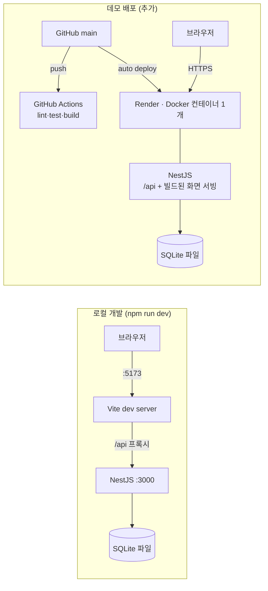
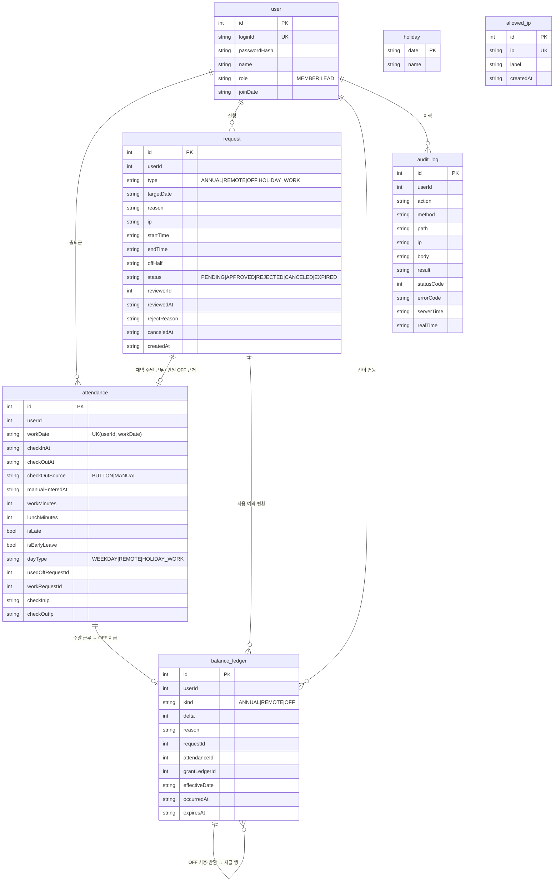

# hiconsy — 팀 근태관리 시스템

[](https://github.com/s0nsy/hiconsy/actions/workflows/ci.yml)

출퇴근 등록, 지각·조퇴 판정, 연차·재택·OFF·주말/공휴일 근무 신청과 잔여 계산, IP 기반 접속 제한, 팀 현황 대시보드, 전체 인터랙션 이력을 제공하는 팀 내부용 근태관리 웹 서비스입니다.

모든 판정은 **서버 시각(Asia/Seoul)** 을 기준으로 하며, 서버의 "현재 시각"과 클라이언트 IP 를 바꿔 가며 경계값과 시나리오를 그대로 재현해 볼 수 있게 만들었습니다.

| 문서                                           | 내용                                                                       |
| ---------------------------------------------- | -------------------------------------------------------------------------- |
| 이 README                                      | 실행 방법 · 기술 스택 · 아키텍처와 컨벤션 · DB 스키마 · 고민한 점          |
| [`docs/policy.md`](docs/policy.md)             | 근태 제도 해석 규칙과 구현하면서 내린 결정 22건(근거 포함)                 |
| [`docs/verification.md`](docs/verification.md) | 시간·IP 바꾸는 법, 인수 시나리오 T-01~T-21 재현 방법, 요구사항별 구현 상태 |
| [`REQUEST.md`](REQUEST.md)                     | 요구사항 정의                                                              |

---

## 1. 실행 방법

### 1.1 로컬 실행

**필요 환경: Node.js 24 (LTS), npm 11.** DB 는 SQLite 파일이라 별도 설치가 필요 없습니다.

```bash
git clone https://github.com/s0nsy/hiconsy.git
cd hiconsy
npm install      # backend·frontend 워크스페이스를 함께 설치
npm run dev      # 백엔드(:3000) + 프론트엔드(:5173) 동시 실행
```

브라우저에서 **<http://localhost:5173>** 에 접속해 아래 계정으로 로그인합니다.

| 이름   | 로그인 ID / 비밀번호 | 역할     | 입사일     |
| ------ | -------------------- | -------- | ---------- |
| 김근태 | `kim` / `1234`       | **리드** | 2026-01-01 |
| 연차원 | `yeon` / `1234`      | 팀원     | 2026-01-15 |
| 임자율 | `lim` / `1234`       | 팀원     | 2026-02-12 |

- 첫 실행 때 `backend/data/hiconsy.sqlite` 가 생기고 계정·2026~2027 공휴일·연구실 IP(`127.0.0.1`)가 자동으로 들어갑니다.
- 로컬 접속은 백엔드에서 `127.0.0.1`(연구실 IP)로 보이므로 바로 출퇴근할 수 있습니다.
- 원문에 리드 지정이 없어 김근태를 리드로 가정했습니다(`backend/src/seed/seed-data.ts` 에서 변경).

### 1.2 기능 확인 — 9장 인수 시나리오 원클릭 재현

화면 우측 하단 **🛠 디버그** → 「9장 시나리오 재현」에서 시나리오를 고르고 **재현** 을 누르면, 데이터·서버 시각·IP·로그인 계정이 그 상황으로 맞춰지고 패널에 할 일과 기대 결과가 표시됩니다.

추천 순서: **T-10**(퇴근 미기록 → 직접 입력) → **T-15**(주말 근무 → OFF 지급) → **T-14**(신청 시간대 밖 IP 차단) → **T-17**(연차 적립) → **T-20**(권한 없는 화면)

서버 시각·IP 를 직접 바꾸는 방법과 21개 시나리오 전체 절차는 [`docs/verification.md`](docs/verification.md) 에 있습니다.

### 1.3 테스트

```bash
npm test         # 백엔드 테스트 104개
npm run lint     # oxlint (type-aware)
npm run build    # 백엔드·프론트엔드 빌드 (프론트는 vue-tsc 타입 검사 포함)
```

| 테스트                    | 위치                                   | 내용                                                             |
| ------------------------- | -------------------------------------- | ---------------------------------------------------------------- |
| 판정 단위 테스트          | `backend/src/*/policy/*.spec.ts`       | 지각·조퇴·근무시간·점심 차감·신청 기한·잔여 계산 경계값          |
| 인수 시나리오 통합 테스트 | `backend/test/scenarios.spec.ts`       | 요구사항 9장 T-01 ~ T-21 을 HTTP 요청으로 검증 (인메모리 SQLite) |
| 원클릭 재현 검증          | `backend/test/dev-scenarios.spec.ts`   | 21개 시나리오의 준비 단계가 실제 규칙을 통과하는지               |
| 규칙 강제                 | `backend/test/no-direct-clock.spec.ts` | 소스 어디에도 `new Date()`·`Date.now()` 직접 호출이 없는지       |

GitHub Actions 가 push·PR 마다 `npm ci → lint → test → build` 를 실행합니다.

### 1.4 환경변수

`backend/.env.development`(레포 포함)에 개발 기본값이 있어 **설정 없이 바로 실행됩니다.** 바꾸려면 `backend/.env` 를 만들면 그 값이 우선합니다.

| 변수                          | 개발 기본값                   | 설명                                                                    |
| ----------------------------- | ----------------------------- | ----------------------------------------------------------------------- |
| `PORT`                        | `3000`                        | API 포트                                                                |
| `ENABLE_TIME_TRAVEL`          | `true`                        | 서버 시각 조작·시나리오 재현 API(`/api/dev/*`) 등록. 운영에서는 `false` |
| `ENABLE_IP_OVERRIDE`          | `true`                        | `X-Debug-Client-IP` 헤더로 클라이언트 IP 위장 허용. 운영에서는 `false`  |
| `REQUIRE_APPROVAL`            | `true`                        | `true`: 리드가 승인한 신청만 효력 / `false`: 제출 즉시 승인             |
| `TRUST_PROXY`                 | `false`                       | express `trust proxy`. 프록시 뒤에서 실제 클라이언트 IP 를 얻을 때 설정 |
| `LAB_IPS`                     | `127.0.0.1`                   | 연구실 IP (쉼표 구분)                                                   |
| `JWT_SECRET`                  | 개발용 값                     | 로그인 쿠키(JWT) 서명 키                                                |
| `COOKIE_SECURE`               | `false`                       | HTTPS 환경에서 `true`                                                   |
| `DATABASE_PATH`               | `backend/data/hiconsy.sqlite` | SQLite 파일 경로                                                        |
| `STATIC_DIR`                  | –                             | 빌드된 화면 경로. 지정하면 API 서버가 화면도 서빙 (배포용)              |
| `OBSERVE_APP_KEY` / `_SECRET` | –                             | NestJS Observe 모니터링. 둘 다 있을 때만 활성화                         |

### 1.5 (추가) 데모 배포

로컬 실행과 별개로, 설치 없이 확인할 수 있도록 데모를 배포해 두었습니다.

**<https://hiconsy-demo.onrender.com>** — 로컬과 같은 계정·디버그 패널을 사용합니다.

- 무료 인스턴스라 한동안 접속이 없으면 첫 로딩에 30초 정도 걸리고, 재배포 시 데이터가 시드 상태로 초기화됩니다.
- 서버 시각은 서버 전체가 공유하므로 여러 명이 동시에 시각을 바꾸면 서로 영향을 줍니다. 정확한 검증은 로컬 실행을 권장합니다.
- 같은 이미지를 로컬에서 실행: `docker build -t hiconsy . && docker run --rm -p 3000:10000 -e ENABLE_TIME_TRAVEL=true -e ENABLE_IP_OVERRIDE=true hiconsy` → <http://localhost:3000>

---

## 2. 기술 스택 및 선택 이유

Vue 3 · NestJS · TypeORM + SQLite · dayjs 는 요구사항에서 지정되었고, 나머지는 아래 이유로 선택했습니다.

### Backend

| 기술                                  | 선택 이유                                                                                                                                             |
| ------------------------------------- | ----------------------------------------------------------------------------------------------------------------------------------------------------- |
| **NestJS 12** (ESM)                   | _요구사항._ 가드·인터셉터·필터를 전역으로 걸 수 있어 "모든 요청에 IP 검사", "모든 인터랙션 이력" 같은 횡단 관심사를 기능 코드와 분리할 수 있었습니다. |
| **TypeORM + SQLite (better-sqlite3)** | _요구사항._ 별도 DB 설치 없이 `npm install` 만으로 실행되게 하기 위함입니다. 엔티티는 PostgreSQL 로 그대로 옮길 수 있는 타입만 사용했습니다.          |
| **dayjs + utc/timezone**              | _요구사항._ 타임존을 `Asia/Seoul` 로 고정하고, 모든 시각 계산을 `ClockService` 한 곳에서 시작하게 했습니다.                                           |
| **Zod**                               | 요청 검증 스키마에서 타입을 추론해 DTO 를 따로 만들지 않아도 됩니다. Nest 의 Standard Schema 검증 파이프(`@Body({ schema })`)로 바로 연결됩니다.      |
| **JWT (HttpOnly 쿠키)**               | 세션 저장소 없이 서버를 단순하게 유지하면서, 토큰을 JS 에서 읽을 수 없게 해 XSS 로 탈취되지 않게 했습니다.                                            |
| **bcryptjs**                          | 비밀번호 해시. 네이티브 빌드가 없어 OS 와 관계없이 설치가 실패하지 않습니다.                                                                          |
| **pdfmake**                           | 신청서 PDF. 헤드리스 브라우저(puppeteer) 없이 가볍게 생성하고, 한글 폰트(Noto Sans KR)를 임베드합니다.                                                |
| **Vitest + supertest**                | NestJS 12 가 ESM 전용이라 Jest 보다 설정 없이 안정적으로 동작합니다. API 는 Jest 와 같습니다.                                                         |
| **oxlint + Prettier**                 | type-aware 린트를 빠르게 돌려 CI 시간을 줄였습니다.                                                                                                   |

### Frontend

| 기술                                             | 선택 이유                                                                                                                                  |
| ------------------------------------------------ | ------------------------------------------------------------------------------------------------------------------------------------------ |
| **Vue 3 (`<script setup>`) + TypeScript + Vite** | _요구사항._                                                                                                                                |
| **Naive UI**                                     | TypeScript 지원과 한국어 로케일, 다크 모드, DataTable·DatePicker·TimePicker 같은 업무 화면 컴포넌트가 충분해서 직접 만들 UI 를 줄였습니다. |
| **Pinia / Vue Router**                           | 인증·서버 시계·시나리오 상태 공유, 역할별 라우트 가드.                                                                                     |

### Infra / 도구

| 기술                              | 선택 이유                                                                                                                                      |
| --------------------------------- | ---------------------------------------------------------------------------------------------------------------------------------------------- |
| **npm workspaces + concurrently** | 루트에서 `npm install`, `npm run dev` 한 번으로 FE/BE 를 함께 설치·실행합니다.                                                                 |
| **GitHub Actions**                | push 마다 lint·테스트·빌드를 깨끗한 환경에서 재확인합니다.                                                                                     |
| **Docker + Render**               | (데모 배포) API 와 화면을 한 컨테이너로 묶어, 로컬과 같은 이미지를 그대로 배포합니다. 설정은 `Dockerfile`, `render.yaml` 에 코드로 남겼습니다. |

---

## 3. 아키텍처 및 컨벤션

### 3.1 인프라



- 로컬에서는 Vite 가 `/api` 를 백엔드로 프록시하므로 화면과 API 가 같은 출처로 동작합니다(쿠키·CORS 설정 불필요).
- 배포에서는 `STATIC_DIR` 로 NestJS 가 빌드된 화면도 서빙해 서버 1개로 운영합니다. `/api` 가 아닌 GET 요청은 SPA 라우팅을 위해 `index.html` 을 돌려줍니다.

### 3.2 소스 코드 구조

```
backend/src
├── common/                  # 모든 기능이 공유하는 기반
│   ├── clock/               # ClockService — "현재 시각"의 유일한 출처 (시간 조작 포함)
│   ├── ip/                  # IpGuard(전역) — 연구실 IP / 승인된 재택·주말 근무 IP·시간대 검사
│   ├── audit/               # AuditInterceptor + AllExceptionsFilter — 모든 요청 이력
│   ├── calendar/            # 영업일·공휴일
│   ├── policy.config.ts     # 근태 규칙 상수 (07:00, 10:00, 16:00, 점심, 한도 …) 한 곳
│   └── errors.ts            # ErrorCode 와 메시지
├── auth/  users/            # JWT 로그인, 역할 가드
├── attendance/              # 출퇴근, 퇴근 미기록 직접 입력
│   └── policy/              # 판정 순수 함수 + 단위 테스트
├── requests/                # 신청·승인·취소·PDF
│   └── policy/
├── balance/                 # 잔여 원장
│   └── policy/
├── dashboard/  settlement/  # 팀 보드·내 카드, 월별 정산
├── dev/                     # 시간 조작·시나리오 재현 (ENABLE_TIME_TRAVEL 일 때만 등록)
└── seed/                    # 최초 실행 시드
backend/test                 # 9장 시나리오 통합 테스트

frontend/src
├── api/client.ts            # 모든 API 호출의 단일 진입점 (오류 코드 변환, IP 위장 헤더)
├── stores/                  # auth · clock(서버 시각) · scenario
├── views/                   # 화면 (라우트 단위)
├── components/              # 내 카드, 퇴근 미기록 모달, 디버그 패널 …
└── router/                  # 로그인·역할 가드
```

**요청 처리 흐름**

```
요청 → IpGuard → AuthGuard → RolesGuard → 검증 파이프(Zod) → Controller → Service → policy 순수 함수
                                                                   │
        AuditInterceptor(성공·실패) / AllExceptionsFilter(가드에서 막힌 요청) → audit_log
```

가드 순서를 IP → 로그인 → 역할로 고정해, 허용되지 않은 IP 는 로그인 여부와 관계없이 먼저 차단합니다. 가드에서 막힌 요청은 인터셉터까지 오지 않기 때문에 예외 필터에서 따로 이력을 남깁니다.

### 3.3 컨벤션

| 구분        | 규칙                                                                                                                                         |
| ----------- | -------------------------------------------------------------------------------------------------------------------------------------------- |
| 현재 시각   | `ClockService` 만 사용. `new Date()`·`Date.now()`·`dayjs()` 직접 호출 금지 — `no-direct-clock.spec.ts` 가 소스를 검사해 강제                 |
| 판정 로직   | `*/policy/*.ts` 에 순수 함수로 둔다 (입력: 시각·설정값, 출력: 판정). DB·현재 시각에 의존하지 않고 같은 폴더의 `*.spec.ts` 로 테스트          |
| 화면과 판정 | 판정은 서버에만 둔다. 버튼 활성 여부도 서버가 같은 함수로 계산해 `canCheckIn` · `reason` 으로 내려준다                                       |
| 오류        | `AppException(ErrorCode.X)` → 응답 `{ code, message, details }`. 프론트는 `code` 로 분기 (예: `ATT_PENDING_CHECKOUT_REQUIRED` → 미기록 모달) |
| 검증        | 요청 본문·파라미터는 Zod 스키마 + `@Body({ schema })`                                                                                        |
| 이력        | 컨트롤러 메서드에 `@Audit('ACTION')`. 본문의 `password`·`token`·`secret` 은 마스킹                                                           |
| 시각 저장   | 순간은 ISO-8601 UTC 문자열, 날짜는 `YYYY-MM-DD` 문자열                                                                                       |
| 모듈        | ESM. 상대 import 는 `.js` 확장자, `__dirname` 대신 `import.meta.dirname`                                                                     |
| 코드 스타일 | Prettier(작은따옴표, trailing comma) + oxlint type-aware. 주석은 "왜"를 한국어로                                                             |
| 커밋        | Conventional Commits (`feat` · `fix` · `refactor` · `docs` · `ci` · `chore`)                                                                 |

---

## 4. 데이터베이스 스키마



| 테이블           | 역할                                                | 인덱스                      |
| ---------------- | --------------------------------------------------- | --------------------------- |
| `user`           | 계정·역할·입사일(연차 적립 기준)                    | `loginId` UNIQUE            |
| `attendance`     | 하루 1행의 출퇴근 기록과 판정 결과                  | `(userId, workDate)` UNIQUE |
| `request`        | 연차·재택·OFF·주말 근무 신청과 승인 상태            | `(userId, targetDate)`      |
| `balance_ledger` | 잔여 변동 원장 (사용 예약 −1, 반환 +1, OFF 지급 +1) | `(userId, kind)`            |
| `audit_log`      | 모든 요청 이력 (서버 시각·실제 시각)                | `(userId, serverTime)`      |
| `holiday`        | 공휴일 (리드가 화면에서 관리)                       | `date` PK                   |
| `allowed_ip`     | 연구실 IP                                           | `ip` UNIQUE                 |

### 설계 이유

- **잔여는 저장하지 않고 원장에서 계산합니다.** `잔여` 컬럼을 두면 신청·취소·반려·만료마다 값을 갱신해야 하고, 한 번 어긋나면 원인을 추적할 수 없습니다. 모든 변동을 `balance_ledger` 에 행으로 남기고 매번 합산하면 "왜 이 값인가"를 언제든 설명할 수 있고, 서버 시각을 과거로 되돌려도 결과가 일관됩니다.
- **연차 적립은 원장에 쓰지 않고 계산합니다.** 적립은 입사일과 현재 시각만으로 정해지는 값이라, 행으로 저장하면 시간 조작 시 "미래에 적립된 행"이 남는 문제가 생깁니다. 사용·반환·OFF 지급처럼 사건이 있는 변동만 원장에 기록합니다.
- **OFF 는 지급 행 단위로 추적합니다.** OFF 는 지급일마다 만료일(근무일 + 30일)이 달라서, 사용·반환 행이 `grantLedgerId` 로 어느 지급분을 썼는지 가리키게 했습니다. 만료가 빠른 것부터 차감(FIFO)하고, 만료 여부는 배치 없이 조회 시점에 계산합니다.
- **신청은 제출 시점에 잔여를 예약 차감합니다.** 승인 전 신청을 여러 건 넣어 한도를 넘는 것을 막기 위해서이고, 반려·취소·미승인 만료(`EXPIRED`) 시 원장에 반환 행을 남깁니다.
- **`attendance` 는 `(userId, workDate)` UNIQUE** 로 하루 1회 출근을 DB 수준에서도 보장합니다. 퇴근 방식(`BUTTON`/`MANUAL`)과 직접 입력 시점을 남겨 "직접 입력" 건을 따로 볼 수 있게 했습니다.
- **이력은 서버 시각과 실제 시각을 함께 저장합니다.** 시간을 조작한 상태에서 남은 기록도 실제로 언제 일어났는지 구분할 수 있게 하기 위함입니다.
- **시각은 ISO-8601 UTC 문자열로 저장합니다.** SQLite 에는 날짜 타입이 없어 드라이버마다 저장 방식이 달라집니다. 문자열은 SQLite·PostgreSQL 어디서나 같게 동작하고 사전순이 곧 시간순이라 범위 조회도 그대로 됩니다.

---

## 5. 개발하면서 고민한 점

### 시간을 어떻게 테스트 가능하게 만들까

근태 규칙은 거의 전부 시각의 경계값(07:00, 10:00:00/10:00:01, 16:00, 전 영업일 17:00, OFF 만료일 23:59:59)에 걸려 있습니다. 실제 시간이 될 때까지 기다리지 않고 검증하려면 서버의 "현재 시각"을 바꿀 수 있어야 했고, 그러려면 **코드 어디서도 시스템 시계를 직접 읽지 않아야** 했습니다.

- `ClockService` 를 유일한 출처로 두고, 직접 호출 금지를 리뷰가 아니라 **테스트로 강제**했습니다.
- 다만 로그인 토큰 만료까지 조작된 시각을 따르면 시간을 앞으로 돌리는 순간 세션이 끊깁니다. 그래서 **보안과 관련된 시간(JWT 만료)은 실제 시각** 을 따르게 분리했습니다.
- "사용일이 되었는데 승인되지 않은 신청은 효력 없음" 처리를 배치로 만들면 시간을 건너뛸 때 배치가 돌지 않습니다. 그래서 **조회·변경 API 진입 시 lazy 하게 처리**해 시간 조작과 맞물리게 했습니다.

### 판정 로직을 어디에 둘까

출근 버튼을 비활성화할지 프론트에서 판단하면, 같은 규칙이 서버와 프론트 두 곳에 생기고 언젠가 어긋납니다. 판정은 **서버의 순수 함수 한 벌** 로만 두고, 버튼 상태와 안내 문구(`canCheckIn`, `reason`)도 서버가 같은 함수로 계산해 내려주게 했습니다. 순수 함수라서 DB 없이 경계값을 촘촘하게 단위 테스트할 수 있었습니다.

### 문서로 정할 수 없는 부분

"점심시간이 근무시간에 포함될 때만 제외"에서 부분 겹침은 어떻게 하는지, 사용일 당일에 승인하면 소급인지, 재택 승인일에 연구실로 출근하면 어떤 근무인지처럼 원문만으로 판단할 수 없는 경우가 여럿 있었습니다. **"사용자에게 불리하지 않으면서 악용 여지가 적은 쪽"** 을 기준으로 정했고, 각각의 근거를 [`docs/policy.md`](docs/policy.md) 에 남겨 규칙이 바뀌면 어디를 고쳐야 하는지 추적할 수 있게 했습니다. 규칙 상수는 `policy.config.ts` 한 곳에 모았습니다.

### 검토하는 사람이 바로 확인할 수 있게

21개 인수 시나리오를 손으로 재현하려면 시각·IP·사전 데이터(예: 주말 근무 신청 → 승인 → 출근 → 퇴근)를 매번 맞춰야 합니다. 이 준비 과정을 **실제 서비스 로직을 그대로 호출해 만드는 "원클릭 재현"** 으로 만들었고, 21개 모두 준비 단계가 규칙을 통과하는지 테스트로 확인합니다. 데이터를 DB 에 직접 넣지 않은 이유는, 재현용 데이터가 실제 규칙과 어긋나면 잘못된 화면을 보여주게 되기 때문입니다.

### 권한 없는 화면의 처리

팀원이 리드 전용 주소에 들어왔을 때 "리드만 볼 수 있습니다"라고 안내하면 그 화면이 있다는 사실이 드러납니다. 권한 없는 화면과 없는 주소를 **같은 "접근할 수 없는 페이지"** 로 보여주게 했습니다. API 는 요구사항(T-20)대로 403 을 반환합니다.

## 6. 아쉬운 점과 개선 방향

| 항목           | 현재                                                                        | 개선 방향                                                                            |
| -------------- | --------------------------------------------------------------------------- | ------------------------------------------------------------------------------------ |
| 테스트 범위    | 판정 함수 단위 + 시나리오 API 통합 테스트. 화면은 원클릭 재현으로 수동 확인 | 핵심 흐름(출근·미기록 입력·신청)을 Playwright E2E 로                                 |
| 외래 키        | 테이블 간 관계를 `userId` 등 정수 컬럼으로만 연결 (FK 제약 없음)            | TypeORM 관계 + FK 제약으로 참조 무결성을 DB 에서 보장                                |
| 스키마 관리    | TypeORM `synchronize` 로 자동 생성                                          | 마이그레이션 도입 (PostgreSQL 전환 시 필수)                                          |
| 시간 조작 상태 | 프로세스 메모리에 있어 재시작하면 초기화, 인스턴스 간 공유 안 됨            | 검증 전용 기능이라 운영에서는 끄는 전제. 다중 인스턴스 검증이 필요하면 공유 저장소로 |
| 연구실 IP      | 정확히 일치하는 값만 허용                                                   | CIDR 대역 지원                                                                       |
| 이력 보관      | 요구사항대로 보관 기간 없이 누적                                            | 보관 정책 + 주기적 아카이브                                                          |
